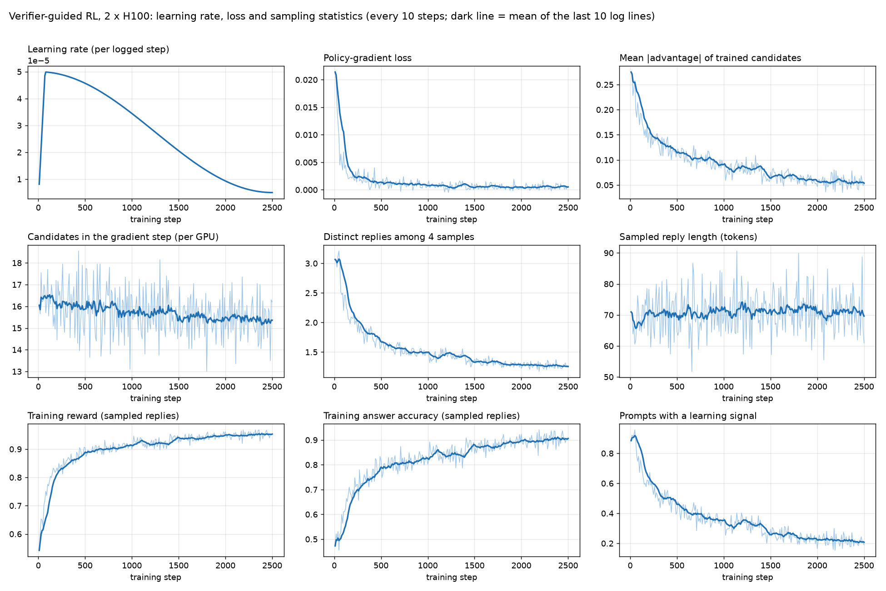
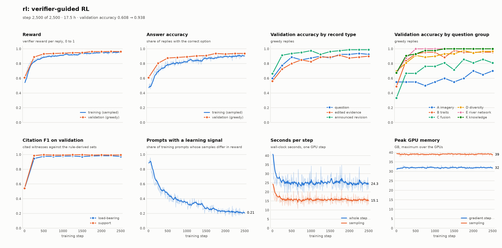

# 强化学习主实验(`configs/rl.yaml`),Lambda 2 × H100,2026-11-12 至 11-13

代码提交 `d262c98`。训练 2,500 步(1,250 次更新,每次 64 个回合),17.5 小时,每卡显存峰值 40 GB。
adapter:<https://huggingface.co/ForeverBlue/EcoWitness-Qwen3.5-9B-RL-LoRA>(公开)。

## 与 `configs/rl.yaml`(4 × A100)的差别

| 参数 | 配置文件 | 本次 | 原因 |
|---|---|---|---|
| GPU | 4 | 2 | 机器只有 2 张 H100 80 GB |
| `prompts_per_step` | 8 | 16 | 每步两卡合计仍是 32 个回合,2,500 步 |
| `grad_accum` | 2 | 2 | 每次更新 64 个回合,1,250 次更新,与原配置相同 |
| `gen_token_budget` | 32,000 | 64,000 | 随每卡回合数翻倍,采样分块数不变 |
| `train_token_budget` | 8,000 | 16,000 | 随每卡回合数翻倍,每个回合进反向的候选数不变 |
| `max_hours` | 23.3 | 0 | 没有 24 小时作业上限 |

没有跑训练前的零样本测试集评测。数据是 2026-11-12 上传的 `data.zip`(记录带 `answer_reward`;三个 split 的记录数和 ID 与 v10 数据包一致)。
先前用每卡 8 个回合、`grad_accum 4` 启动过一次,40 步后停掉改成现在的设置,没有保留任何权重。

## 验证曲线(固定 240 条验证记录,每种记录 80 条,贪心解码)

| 步数 | 奖励 | 答案正确率 | 原题 | 静默编辑 | 带通知修订 | load_bearing F1 | support F1 |
|---|---|---|---|---|---|---|---|
| 0 | 0.608 | 0.608 | 0.600 | 0.562 | 0.662 | 0.536 | 0.541 |
| 250 | 0.888 | 0.804 | 0.775 | 0.725 | 0.912 | 0.945 | 0.985 |
| 500 | 0.931 | 0.875 | 0.887 | 0.800 | 0.938 | 0.976 | 0.996 |
| 750 | 0.937 | 0.883 | 0.850 | 0.850 | 0.950 | 0.974 | 0.992 |
| 1000 | 0.940 | 0.892 | 0.875 | 0.825 | 0.975 | 0.977 | 0.993 |
| 1250 | 0.947 | 0.904 | 0.900 | 0.887 | 0.925 | 0.980 | 0.997 |
| 1500 | 0.948 | 0.908 | 0.875 | 0.887 | 0.963 | 0.972 | 0.998 |
| 1750 | 0.963 | 0.938 | 0.925 | 0.912 | 0.975 | 0.980 | 0.992 |
| 2000 | 0.962 | 0.929 | 0.925 | 0.875 | 0.988 | 0.983 | 0.996 |
| 2250 | 0.964 | 0.938 | 0.938 | 0.887 | 0.988 | 0.982 | 0.993 |
| 2500 | 0.963 | 0.938 | 0.925 | 0.900 | 0.988 | 0.974 | 0.994 |

按题组的正确率(每组只有几条到几十条,单组数字波动大):

| 题组 | 训练前 | 第 2,500 步 |
|---|---|---|
| A 影像 | 0.55 | 0.70 |
| B 群落性状 | 0.49 | 0.95 |
| C 融合 | 0.33 | 0.81 |
| D 多样性 | 0.70 | 0.97 |
| E 河网 | 0.67 | 1.00 |
| K 物种知识 | 0.67 | 1.00 |

- 提升大部分在前 500 步;之后缓慢上升,第 1,750 步后总体正确率停在 0.93–0.94(240 条时 95% 区间约 ±3–4 个点)。
- 影像题(A 组)提升最小。LoRA 只挂在语言模型上(`lora_merger: false`),视觉侧没有训练。
- 四个采样回答得分不全相同的回合占比从 0.89 降到 0.21;训练末段采样正确率 0.90。

## 训练细节

### 全部超参数(`config.json`)

| 项 | 值 |
|---|---|
| 底座 | Qwen/Qwen3.5-9B,全部冻结;bf16;梯度检查点开启;注意力实现 `sdpa` |
| LoRA | r = 32,alpha = 64,dropout = 0.0;挂在语言模型的 q/k/v/o、Gated DeltaNet 的 in_proj*/out_proj、MLP 的 gate/up/down;视觉塔和视觉融合层不训(`lora_merger: false`)|
| 可训练参数 | 86,556,672(全部 9,496,370,416 的 0.91%) |
| 优化器 | AdamW,weight decay 0,梯度裁剪 max_grad_norm = 1.0 |
| 学习率 | 峰值 5e-05;预热占更新数的 0.03(37 次更新 = 74 步,线性);之后余弦衰减到峰值的 10%(5e-6) |
| 更新 | 2,500 步,每 2 步更新一次,共 1,250 次;每次更新 2 卡 × 16 回合 × 2 = 64 个回合 |
| 回合 | 80,000 个,从 train 抽取:base 32,000 / silent 28,000 / revise 20,000(权重 [0.4, 0.35, 0.25]);参考回答超过 300 token 的 4,156 条记录不用 |
| 采样 | 每个回合 4 个回答,温度 1.0,不做 top-k / top-p;每个回答最多 1.3 × 参考长度 + 16 个 token,上限 320;不开推理块(`think: false`) |
| 奖励 | 答案 0.6(接近的答案给部分分,上限 0.5)+ load_bearing F1 0.25 + support F1 0.15;修订题另加 `changed` 行 0.15 |
| 优势 | 回答的奖励 − 同一回合 4 个回答的平均奖励;不做方差归一化 |
| 参考回答示范 | 每个回合以 0.5 的概率加入,系数 1.0,优势 = 1 − 采样平均奖励(为正才加入) |
| token 预算 | 采样 `gen_token_budget` 64,000;反向 `train_token_budget` 16,000 |
| 验证 | 每 250 步,固定 240 条 val 记录,贪心解码 |
| 随机种子 | 0 |
| 存档 | 每 250 步一个 checkpoint(adapter + 优化器和学习率进度),保留最近 2 个 |
| 硬件与耗时 | 2 × NVIDIA H100 80 GB(驱动 580.105.08,Ubuntu 22.04);17.54 小时;显存峰值:采样 40.0 GB,反向 33.2 GB |
| 软件 | Python 3.12.16,torch 2.7.1+cu126,transformers 5.22.2,peft 0.21.2,accelerate 1.15.0,flash-linear-attention 0.6.0;没有装 causal-conv1d(走 torch 实现)。完整列表 `environment/pip_freeze.txt` |

### 学习率、loss 和采样统计(每 250 步的平均;逐 10 步的原始值在 `training_log.csv`)

| 步数区间 | 学习率(区间末) | loss | 训练奖励 | 训练正确率 | 平均 \|优势\| | 每卡进反向的候选数 | 有学习信号的回合占比 | 4 个采样里不同回答数 | 回答长度(token) | 每步秒数 | 采样秒数 | 反向秒数 |
|---|---|---|---|---|---|---|---|---|---|---|---|---|
| 1–250 | 4.89e-05 | 0.0058 | 0.762 | 0.621 | 0.183 | 16.2 | 0.71 | 2.39 | 69 | 27.3 | 17.2 | 8.9 |
| 251–500 | 4.57e-05 | 0.0016 | 0.870 | 0.758 | 0.126 | 15.9 | 0.49 | 1.77 | 71 | 25.1 | 15.7 | 7.7 |
| 501–750 | 4.07e-05 | 0.0012 | 0.898 | 0.801 | 0.105 | 16.1 | 0.40 | 1.57 | 70 | 24.3 | 15.3 | 7.1 |
| 751–1000 | 3.45e-05 | 0.0009 | 0.908 | 0.816 | 0.096 | 15.8 | 0.36 | 1.49 | 72 | 25.1 | 15.9 | 7.6 |
| 1001–1250 | 2.75e-05 | 0.0007 | 0.922 | 0.845 | 0.082 | 15.7 | 0.33 | 1.44 | 71 | 24.7 | 15.6 | 7.3 |
| 1251–1500 | 2.05e-05 | 0.0007 | 0.928 | 0.855 | 0.076 | 15.6 | 0.30 | 1.39 | 71 | 25.5 | 15.7 | 8.3 |
| 1501–1750 | 1.43e-05 | 0.0006 | 0.938 | 0.873 | 0.068 | 15.6 | 0.26 | 1.33 | 71 | 25.4 | 15.7 | 7.8 |
| 1751–2000 | 9.30e-06 | 0.0004 | 0.947 | 0.893 | 0.060 | 15.4 | 0.23 | 1.29 | 73 | 25.4 | 15.9 | 7.3 |
| 2001–2250 | 6.10e-06 | 0.0005 | 0.948 | 0.896 | 0.058 | 15.5 | 0.22 | 1.27 | 70 | 24.6 | 15.5 | 7.2 |
| 2251–2500 | 5.00e-06 | 0.0005 | 0.952 | 0.904 | 0.055 | 15.4 | 0.21 | 1.27 | 71 | 24.8 | 15.5 | 7.5 |

- **loss 的含义**:它是策略梯度的代理损失,− Σ 优势 × 回答各 token 的平均对数概率 ÷ 回合数。优势有正有负,所以它接近 0、可以为负(全程最小 −0.0005,最大 0.0214),不是越小越好的拟合误差。它变小主要是因为优势变小:模型的采样回答越来越一致,平均 |优势| 从 0.18 降到 0.055。看学习效果要看奖励和验证正确率。
- **学习率**:第 80 步到峰值 4.99e-5,结束时 5e-6。
- **每步耗时**约 25 秒,其中采样约 15.5 秒、反向约 7.5 秒;全程稳定。
- **训练正确率低于验证正确率**(末段 0.90 对 0.94):训练指标是温度 1 采样的回答,验证是贪心解码。

## 测试集(7,523 题,73,245 条记录,英文;贪心解码,生成 batch 32,`max_new_tokens` 640)

两张卡分别跑 base + silent 和 revise + chain,合并预测后用 `ecowitness.score` 统一打分(`scripts/run_eval_lambda.sh`)。完整指标在 `eval_test/metrics.json`。

| 记录类型 | 条数 | 答案正确率(%) | 95% 区间 |
|---|---|---|---|
| 原题 base | 7,523 | 90.9 | [90.2, 91.5] |
| 静默编辑 silent | 32,461 | 91.0 | [90.8, 91.4] |
| 带通知修订 revise | 25,738 | 95.7 | [95.5, 96.0] |
| 修订链 chain,末步 | 7,523 | 81.0 | [80.1, 81.9] |

按题组(%):

| 题组 | 原题 | 静默编辑 | 带通知修订 |
|---|---|---|---|
| A 影像 | 72.3 | 75.9 | 65.8 |
| B 群落性状 | 95.0 | 93.7 | 98.8 |
| C 融合 | 92.6 | 88.0 | 89.5 |
| D 多样性 | 94.1 | 92.4 | 98.4 |
| E 河网 | 100.0 | 99.7 | 99.6 |
| K 物种知识 | 98.4 | 96.9 | 99.3 |

静默反事实(编辑后的证据作为新题,没有通知):

| 指标 | 值(%) |
|---|---|
| 不变率(真值不变时答案没变) | 95.2 [94.8, 95.5] |
| 翻转率(真值变了时答案变了) | 90.1 |
| 翻转正确率(变成了新的正确答案) | 89.0 [88.5, 89.6] |
| 选项置换等变率 | 95.8 |
| 归因忠实度(声称的承重证人 vs 删除后答案是否真的改变,一致率) | 95.3 (F1 95.1, n = 10,419) |
| 通知依赖(有通知的翻转正确率 − 静默翻转正确率) | +4.2 |

| 编辑轴 | 条数 | 不变率 | 翻转正确率 |
|---|---|---|---|
| 物种替换 | 6,481 | 99.0 | 84.0 |
| 功能性状 | 1,264 | 99.9 | 93.9 |
| reads 占比 | 918 | 98.1 | 89.7 |
| 保护 / 原生状态 | 1,085 | 96.6 | 91.1 |
| 撤销 / 新增证人 | 10,470 | 98.2 | 92.0 |
| 换影像 | 3,433 | 69.4 | 81.6 |
| 站点记录 | 1,287 | 99.6 | 99.0 |

带通知的单步修订:

| 指标 | 值(%) |
|---|---|
| 该变的题(flip)正确率 | 93.1 |
| 不该变的题(keep)正确率 | 97.7 |
| 惯性率(该变没变) | 2.0 [1.8, 2.2] |
| 传染率(改了无关证人却变了) | 0.18 |
| 冗余过度反应率(改了被引用的冗余证人却变了) | 5.8 |
| `changed` F1 | 97.4 |

修订链(2–5 步,每步看到的是模型自己之前的回答):

| 步 | 0(原题) | 1 | 2 | 3 | 4 | 5 |
|---|---|---|---|---|---|---|
| 正确率(%) | 90.9 | 88.7 | 85.7 | 82.4 | 80.5 | 77.0 |

整链全对率 69.7%;漂移(原题正确率 − 末步正确率)9.9 个点;错了之后的恢复率 38.5%;对了之后的滑落率 8.8%。

引用(原题):support F1 99.8,load_bearing F1 98.3,答对且承重集合全对 88.5%,编造编号 0。格式解析率 100%。

原题正确率最低的题族:A5-Sinuosity 45.2, A6-RiparianVegetation 48.2, B6-StatusCount 60.1, A7-BuiltUpBank 64.0, C1-SceneAndCommunity 64.8, A1-NearshoreCover 71.4。

要点:

- **影像是短板。** A 组原题 72.3%,换影像的修订题 68.4%(惯性率 12.9%),换影像的静默题不变率只有 69.4%。有序影像类别里 23.2% 错到相邻等级,7.2% 错得更远。LoRA 没挂视觉侧(`lora_merger: false`)。
- **留出的 C1 题族(训练里没有)原题 64.8%**,明显低于训练过的题族;它同时依赖影像。
- **链上逐步下降**:每多一步约掉 2–3 个点,错了之后只有 38.5% 能改回来。训练只用了单步记录,没有链。
- **物种替换(taxonomy)的翻转正确率 84.0%**,是非影像轴里最低的;同科异性状的替换最难(78.6%)。
- **没有训练前的零样本测试集结果可比**(按要求没有跑)。参照 README 的合成基线:随机原题正确率 25.3%;"永远不改"在修订题上 55.7%、惯性率 100%。
- 单次训练、单个种子;区间是测试集自助法的抽样区间,不含训练随机性。

## 文件

| 文件 | 内容 |
|---|---|
| `rl_log.jsonl`、`training_log.csv` | 每 10 步一行的训练指标(两卡合计),30 列:学习率、loss、奖励、正确率(总体、按记录类型、按题组)、引用 F1、平均 \|优势\|、候选数、每步 / 采样 / 反向秒数、显存峰值等。CSV 与 jsonl 内容相同 |
| `val_log.jsonl`、`validation_log.csv` | 第 0 步、每 250 步和结束时的验证指标 |
| `config.json`、`adapter_config.json`、`progress.json` | 本次运行的完整配置(路径改成了占位)、LoRA 配置、结束时的进度 |
| `curves.png/pdf`、`lr_loss_curves.png/pdf` | 训练曲线(`ecowitness/plot_rl.py`);学习率、loss 和采样统计 |
| `eval_test/metrics.json` | 测试集评测的全部指标(7,523 题,73,245 条记录) |
| `eval_test/parts/` | 两张卡各自那一半的指标(base + silent;revise + chain) |
| `run_logs/` | 训练的完整终端输出、评测输出、环境检查输出、第一次启动(40 步)的输出 |
| `first_start_8x4/` | 第一次启动(每卡 8 个回合,40 步后停掉)的日志和配置 |
| `environment/` | `pip_freeze.txt`、机器信息 |
| `data_stats/` | 训练数据的 `stats.json`、`build_args.json` |
| `scripts/` | Lambda 上的环境变量、训练启动脚本、双卡评测脚本(不依赖 Slurm 和 module) |

不在这个仓库里的:

| 内容 | 位置 |
|---|---|
| 最终 adapter(346 MB) | <https://huggingface.co/ForeverBlue/EcoWitness-Qwen3.5-9B-RL-LoRA> |
| checkpoint-2250、checkpoint-2500(各 1 GB,含优化器状态,可用 `--resume true` 接着训) | 同一个 Hugging Face 仓库的 `checkpoints/` |
| 测试集逐条预测 `predictions.jsonl`(18 MB) | Hugging Face 私有数据集仓库 `ForeverBlue/EcoWitness-RL-test-predictions`(公开它等于公开大部分测试答案,所以设为私有) |

